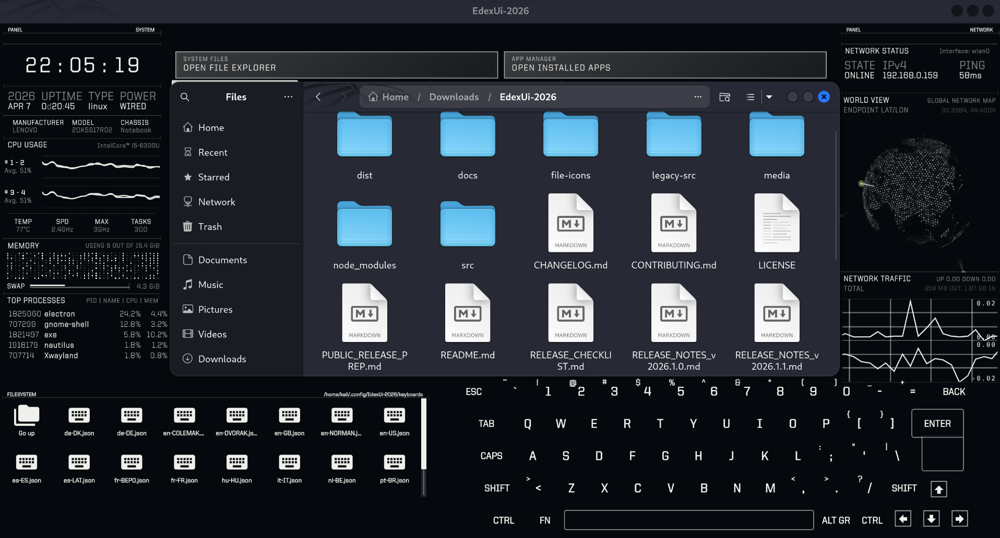
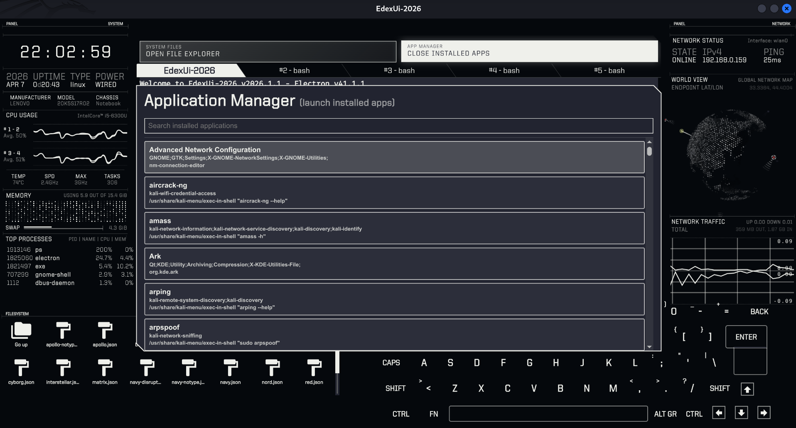
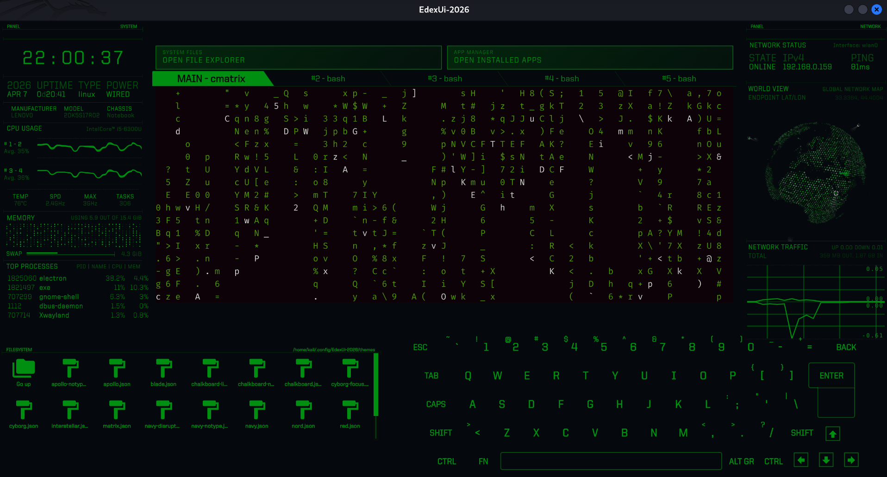

# EdexUi-2026

[](https://github.com/Ali-A-Alwahed/EdexUi-2026/releases/latest)
[](https://github.com/Ali-A-Alwahed/EdexUi-2026/releases/latest)
[](LICENSE)

A maintained continuation of the original **eDEX-UI** — a sci-fi terminal
operating-system interface — rebuilt for current Linux, Windows and macOS
systems.

> **EdexUi-2026 is a fork, not a rewrite.** It descends from
> [GitSquared/edex-ui](https://github.com/GitSquared/edex-ui) by
> Gabriel "Squared" Saillard and remains GPL-3.0 licensed.
> See [CREDITS.md](docs/CREDITS.md) for full attribution.

## Quick navigation

- [Screenshots](#screenshots)
- [Features](#features)
- [Install](#install)
- [Run from source](#run-from-source)
- [Build packages](#build-packages)
- [Using the app](#using-the-app)
- [Development](#development)
- [Contributing](#contributing)
- [Security](#security)
- [Credits](#credits)

## Screenshots

### Main interface



### Application manager



### Startup screen



## Features

- **Terminal** — `xterm.js` with multiple tabs, ligatures and a real PTY
  (`node-pty`)
- **System modules** — CPU, RAM, disk, network, hardware inspector, process
  list and netstat graphs
- **File explorer** — browse the filesystem, open files, edit and save
- **Application manager** — list and launch installed desktop applications
- **3D globe** — plots live connections on a WebGL world view
- **On-screen keyboard** — multiple layouts including DVORAK, COLEMAK and
  Workman
- **21 themes** — including tron, matrix, cyberpunk, nord and apollo
- **Audio feedback** — optional sound effects for events and keystrokes
- **Settings editor** — configure shell, theme, keyboard, monitor and more

## Install

Download a build for your platform from the
[latest release page](https://github.com/Ali-A-Alwahed/EdexUi-2026/releases/latest):

| Platform | Formats |
| --- | --- |
| Linux | `.AppImage`, `.deb`, `.rpm` |
| Windows | `.exe` (NSIS installer) |
| macOS | `.dmg` |

Public binaries are unsigned unless a release is signed. See
[SIGNING.md](docs/SIGNING.md) for how to add your own credentials.

## Run from source

Requirements: **Node.js 22.12 or newer** and npm.

```bash
git clone https://github.com/Ali-A-Alwahed/EdexUi-2026.git
cd EdexUi-2026

npm install                # build tooling (Electron, electron-builder, ...)
npm run install-linux      # app dependencies + native node-pty rebuild
```

Then start it:

```bash
npm start                  # normal start
npm run start:fast         # skip the intro animation
```

> `npm run install-linux` is what rebuilds `node-pty` against your local
> Electron build. Without it the terminal will not start.

## Build packages

```bash
npm run prebuild-linux     # stage + minify sources
npm run build-linux        # AppImage, deb, rpm
```

macOS and Windows have `build-darwin` / `build-windows` counterparts. These
must be run on the matching operating system, since the native `node-pty`
module is compiled per platform.

## Using the app

| Action | How |
| --- | --- |
| Open settings | the **settings.json** icon in the system panel |
| Browse files | the **SYSTEM FILES** button at the top |
| Launch an app | the **APP MANAGER** button at the top |
| Switch tabs | the numbered tabs, or the on-screen keyboard |
| Fullscreen on/off | the fullscreen toggle (remembered between launches) |
| Quit | type `exit` in the terminal |

The window starts **fullscreen**. You can leave fullscreen with the toggle,
and your choice is remembered.

## Development

```bash
npm test          # run the regression test suite (vitest)
npm run test:watch
npm run audit     # dependency security audit for both manifests
```

Layout:

```
src/               application source (Electron main + renderer)
  _boot.js         main process
  _renderer.js     renderer entry
  classes/         UI modules
  assets/          themes, css, audio, fonts, keyboard layouts
test/              regression tests
docs/              project documentation
media/             icons and screenshots
```

## Contributing

Improvements are welcome. Please read [CONTRIBUTING.md](docs/CONTRIBUTING.md)
before opening a pull request, and note that contributions are accepted under
the same GPL-3.0-or-later licence.

## Security

Please review [SECURITY.md](docs/SECURITY.md) for how to report a
vulnerability. Security reports should not be filed as public issues.

## Credits

- Original **eDEX-UI** by **Gabriel "Squared" Saillard** and contributors
- **ENCOM Globe** fork by **Rob "arscan" Scanlon**, bundling three.js
- Special thanks to **Hyder6112** and **Ahmed Adnan**
- **2026 maintainer:** Ali-A-Alwahed

Full details in [CREDITS.md](docs/CREDITS.md) and [NOTICE](docs/NOTICE).

## License

Because this project is derived from the GPL-licensed eDEX-UI codebase, it
remains licensed under **GPL-3.0-or-later**. See [LICENSE](LICENSE).
